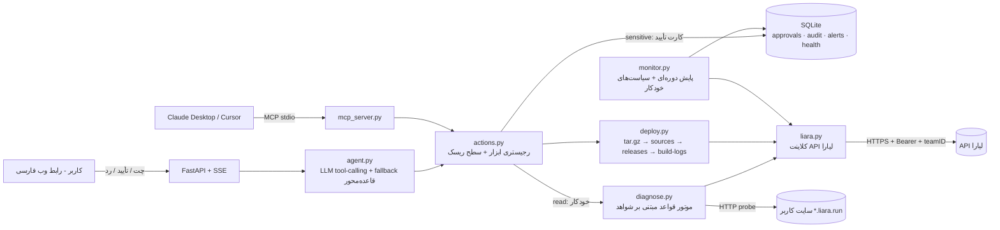

# سکان (Sokan) — همکار فنی هوشمند روی لیارا

> دستیار DevOps برای صاحبان وب‌سایت: از اولین دیپلوی و انتخاب پلن، تا پایش دائمی، عیب‌یابی مبتنی بر شواهد و رفع مشکل — **هر تغییری فقط با تأیید شما**.

سکان یک **AI Agent + رابط وب فارسی + سرور MCP** است که مستقیماً با **API رسمی لیارا** کار می‌کند. کاربر به زبان ساده می‌نویسد «سایتم ارور ۵۰۰ می‌ده»؛ سکان لاگ‌ها، وضعیت کانتینر، release ها، مصرف CPU/RAM در مقایسه با سقف پلن و پاسخ واقعی سایت را جمع می‌کند، علت‌ها را با درصد اطمینان و شواهد رتبه‌بندی می‌کند، راه‌حل را به‌صورت یک «کارت تأیید» با اثر و هزینه‌ی دقیق پیشنهاد می‌دهد و بعد از تأیید، اجرا و **نتیجه را دوباره بررسی** می‌کند.

---

## سناریوهای واقعی (روی حساب واقعی لیارا اجرا شده)

| # | کاربر می‌گوید | سکان چه می‌کند |
|---|---|---|
| ۱ | «پروژه‌ی `demo-app` را روی لیارا بالا بیاور» | تحلیل پروژه (Dockerfile، پورت 8000، متغیر لازم `DATABASE_URL`) → پیشنهاد ارزان‌ترین پلن مناسب با قیمت واقعی از API (`small-g2` + `basic`، ~۷۵۰ هزار تومان/ماه) → کارت تأیید ساخت برنامه → **تشخیص خودکار پیش‌نیاز** (برنامه‌های نسل ۲ شبکه‌ی خصوصی لازم دارند؛ ساخته می‌شود) → کارت تأیید دیپلوی → بسته‌بندی، آپلود، **لاگ زنده‌ی build**، انتظار برای گرم شدن کانتینر و تست سایت |
| ۲ | «سایتم ارور ۵۰۰ می‌ده» | عیب‌یابی: `KeyError: 'DATABASE_URL'` در لاگ + متغیر در تنظیمات برنامه نیست + صفحه‌ی اصلی 500 + ۴ درخواست 5xx ← علت با **۹۹٪** اطمینان؛ CPU/RAM رد می‌شوند. مقدار محرمانه را **از کاربر می‌پرسد** (هرگز حدس نمی‌زند) → کارت تأیید با مقدار پوشانده (`po••••••nd`) و حفظ بقیه‌ی متغیرها → اجرا → بررسی: سایت 200 |
| ۳ | «سایتم سنگین شده، ممکنه کرش کنه؟» | تشخیص **نشت حافظه** از روند متریک (۳۳MB → ۳۸۴MB، ۸۲٪ سقف پلن) → پیشنهاد ری‌استارت به‌عنوان مسکّن + توضیح نیاز به اصلاح کد → اجرا → اندازه‌گیری: RAM از ۳۸۵MB به ۳۳MB |
| ۴ | (بدون پیام) | پایش خودکار هر ۶۰ ثانیه: هشدار پاسخ‌ندادن/5xx، کندی، RAM/CPU نزدیک سقف، افزایش خطا؛ سیاست‌های خودکار اختیاری (مثلاً ری‌استارت خودکار در صورت ۳ بار خطای متوالی) |

---

## معماری



| ماژول | نقش |
|---|---|
| `backend/app/liara.py` | کلاینت async روی endpointهای مستند لیارا؛ تبدیل خطاها به پیام فارسی؛ retry فقط برای GETها |
| `backend/app/diagnose.py` | جمع‌آوری موازی شواهد + **۱۵+ قاعده** (OOM، متغیر محیطی، اتصال DB، ماژول جاافتاده، پورت/bind، دیسک پر، FS فقط‌خواندنی، تایم‌اوت، Exception، فشار/نشت حافظه، اشباع CPU، کندی، کرش‌لوپ، release ناموفق، برنامه‌ی خاموش، در حال راه‌اندازی، خطای قبلاً رفع‌شده) با ترکیب noisy-OR و رتبه‌بندی |
| `backend/app/actions.py` | ابزارها با سطح ریسک `read` / `sensitive` / `critical`، متن «اثر عملیات» (چه می‌شود، قطعی، هزینه، برگشت‌پذیری)، اجرا + **راستی‌آزمایی** |
| `backend/app/agent.py` | حلقه‌ی tool-calling با مدل ارزان (`gpt-6-luna`، سقف بودجه)، ادامه‌ی خودکار برنامه پس از هر تأیید، و fallback قاعده‌محور وقتی LLM در دسترس نیست |
| `backend/app/monitor.py` | پایش دوره‌ای، هشدار، سیاست‌های خودکار با «تأیید دائمی» |
| `backend/app/mcp_server.py` | همان ابزارها برای کلاینت‌های MCP؛ ابزار حساس فقط درخواست تأیید می‌سازد |
| `frontend/` | React + Tailwind، راست‌به‌چپ، تم تیره‌ی هم‌خوان با پنل لیارا |
| `demo-app/` | سایت نمونه‌ی «کافه‌لند» با باگ‌های قابل‌کنترل برای دمو |

### چرا قاعده + LLM؟
تشخیص علت با **موتور قواعد قطعی** انجام می‌شود (قابل‌اعتماد، قابل‌تست، بدون هزینه) و LLM فقط برای فهم زبان کاربر، انتخاب ابزار و توضیح ساده استفاده می‌شود. نتیجه: هر سؤال حدود **۰٫۰۰۰۱ دلار** و حتی بدون LLM هم سیستم کار می‌کند.

---

## اتصال به API لیارا

- **احراز هویت:** `Authorization: Bearer <API token>` (از `console.liara.ir/API`). توکن از متغیر `LIARA_API_TOKEN` یا فایل خوانده می‌شود و هرگز در لاگ/خروجی چاپ نمی‌شود.
- **فضای کاری تیمی:** اگر اعتبار روی تیم باشد، سکان با `GET /v2/teams` و `GET /v1/billing?teamID=` تیم دارای اعتبار را خودکار پیدا می‌کند و `teamID` را به همه‌ی درخواست‌ها اضافه می‌کند (همان رفتار CLI رسمی).
- **Base URL:** `https://api.iran.liara.ir` و `https://dns-service.iran.liara.ir`

| کاربرد | Endpoint |
|---|---|
| حساب، پلن‌ها و قیمت‌ها | `GET /v1/me`, `GET /v1/billing`, `GET /v2/teams` |
| برنامه‌ها | `GET/POST /v1/projects`, `GET/DELETE /v1/projects/{name}` |
| شبکه (پیش‌نیاز نسل ۲) | `GET/POST /v1/networks` |
| ری‌استارت / روشن‌خاموش / پلن | `POST /v1/projects/{name}/actions/restart`, `.../actions/scale`, `.../resize` |
| متغیرهای محیطی | `POST /v1/projects/update-envs` (کل مجموعه جایگزین می‌شود → سکان ادغام می‌کند) |
| دیپلوی | `POST /v2/projects/{name}/sources` → `POST /v2/projects/{name}/releases` → `GET /v2/releases/{id}/build-logs` |
| لاگ | `GET /v2/projects/{name}/logs?start=` |
| متریک | `GET /v1/projects/{name}/metrics/{cpu,memory,network-receive,network-transmit,summary}` |
| release ها و کانتینرها | `GET /v1/projects/{name}/releases`, `.../applets` |
| دامنه و DNS | `GET/POST /v1/domains`, `GET /v1/domains/{id}/check`, `/api/v1/zones…` |

### نکات کشف‌شده از API واقعی (و نحوه‌ی مدیریت)
| رفتار API | راه‌حل در سکان |
|---|---|
| ساخت برنامه‌ی نسل ۲ بدون شبکه خطای `g2_plan_unavailable` می‌دهد | اگر شبکه نباشد، `sokan-net` (رایگان) در همان مرحله ساخته می‌شود و در کارت تأیید اعلام می‌شود |
| هر خط لاگ به‌صورت JSON است: `{"type":"stderr","_entry":"…"}` | باز کردن و نگه‌داشتن stream |
| پارامتر `start` لاگ‌ها دقیق رعایت نمی‌شود | فیلتر سمت کلاینت — وگرنه «بعد از اصلاح» خطاهای قدیمی دیده می‌شد |
| متریک‌ها برای هر نمونه‌ی کانتینر جداست و نمونه‌ی قدیمی بعد از ری‌استارت تا مدتی گزارش می‌دهد | در هر لحظه فقط جدیدترین نمونه (جمع زدن نتیجه را غلط می‌کرد) |
| تا ~۳۰ ثانیه بعد از release، edge کد 503 می‌دهد | انتظار برای گرم شدن قبل از قضاوت + فرضیه‌ی «در حال راه‌اندازی» |
| `GET …/applets` گاهی 500 می‌دهد | جمع‌آوری شواهد مقاوم: نبودِ یک منبع، تشخیص را متوقف نمی‌کند |

---

## تعامل کاربر با سیستم

1. **چت ساده‌ی فارسی** + پیشنهادهای آماده‌ی کلیک‌شدنی؛ برنامه‌ی انتخاب‌شده در داشبورد به‌عنوان زمینه به دستیار داده می‌شود.
2. **تایم‌لاین مراحل**: «در حال دریافت لاگ‌ها ✓ / بررسی مصرف منابع ✓ …» تا کاربر بداند دستیار چه می‌کند.
3. **کارت‌های نتیجه**: گزارش عیب‌یابی (علت‌ها با درصد و شواهد قابل باز شدن، دکمه‌ی راه‌حل)، نمودار CPU/RAM با خط سقف پلن، لاگ‌ها با برجسته‌سازی خطا، پیشنهاد پلن با قیمت.
4. **کارت تأیید (Human-in-the-loop)** برای هر تغییر: چه می‌شود، دلیل، اثر روی دسترس‌پذیری، هزینه، برگشت‌پذیری، مقادیر محرمانه‌ی پوشانده. عملیات بحرانی (حذف) نیاز به **تایپ نام برنامه** دارد.
5. **پیشرفت زنده‌ی اجرا** (مراحل + لاگ build) و **پیام نتیجه‌ی راستی‌آزمایی‌شده** (کد پاسخ سایت، RAM قبل/بعد). پس از تأیید، دستیار گام بعدی برنامه را خودش پیشنهاد می‌دهد (ساخت → دیپلوی).
6. **داشبورد برنامه**: پاسخ سایت، دسترس‌پذیری، نمودارها، سیاست‌های خودکار، آخرین release ها.
7. **گزارش عملیات (Audit)**: هر خواندن/درخواست/تأیید/رد/اجرا با عامل (شما، دستیار، سیاست خودکار) و نتیجه.
8. **محدودیت‌های API** در یک صفحه‌ی جدا و هر وقت کاربر چیزی ناممکن بخواهد.

### سطح‌بندی ریسک
| سطح | مثال | رفتار |
|---|---|---|
| خواندنی | لاگ، متریک، وضعیت، عیب‌یابی، تحلیل پروژه | خودکار |
| حساس | ری‌استارت، متغیر محیطی، دیپلوی، rollback، تغییر پلن، ساخت برنامه، دامنه | کارت تأیید |
| بحرانی | حذف برنامه | تأیید + تایپ نام برنامه |
| سیاست خودکار | ری‌استارت در قطعی/RAM بحرانی | فقط اگر کاربر صریحاً فعال کند؛ حداکثر هر ۳۰ دقیقه؛ ثبت در audit |

---

## محدودیت‌ها (صادقانه)

- **ایرنیک/رجیسترار** API عمومی ندارد → سکان دامنه را در لیارا ثبت و رکورد لازم را دقیق نشان می‌دهد؛ تغییر NS/CNAME را کاربر انجام می‌دهد و سکان بعد بررسی می‌کند.
- **شارژ حساب** از API ممکن نیست؛ موجودی و هزینه‌ی روزانه نمایش داده می‌شود.
- **متریک سطح درخواست** (p95، تعداد درخواست) در API نیست → تست HTTP بیرونی + تحلیل access log.
- **مقیاس افقی/autoscale**: `scale` فقط ۰/۱ است → ارتقای عمودی پلن.
- **shell داخل کانتینر** فقط با WebSocket تعاملی است و برای امنیت فعال نشده.
- **Rollback** فقط برای نسخه‌هایی که با سکان منتشر شده‌اند (سورس هر انتشار نگه داشته می‌شود)؛ endpoint عمومی rollback مستند نیست.
- **Webhook/push** از لیارا وجود ندارد → پایش دوره‌ای ۶۰ ثانیه‌ای.
- **تغییر کد** برنامه انجام نمی‌شود؛ اصلاح پیشنهاد و پس از اعمال، دیپلوی و بررسی می‌شود.
- مدل زبانی محدود به بودجه است (`LLM_BUDGET_USD`)؛ پس از آن fallback قاعده‌محور فعال می‌شود.
- مقادیر متغیرهای محیطی در پایگاه داده‌ی محلی سکان برای اجرای پس از تأیید نگه داشته می‌شوند (در audit و UI پوشانده‌اند).

---

## اجرا

```bash
# پیش‌نیاز: Python 3.10+، Node 20+
python -m venv .venv && .venv\Scripts\pip install -r requirements.txt
cd frontend && npm install && npm run build && cd ..
set LIARA_API_TOKEN=...      # یا فایل "..\Liara API KEy.txt"
set LLM_API_KEY=...          # اختیاری (BoxAPI / OpenAI-compatible)؛ بدون آن fallback قاعده‌محور
.venv\Scripts\python -m uvicorn app.main:app --app-dir backend --port 8010
# http://127.0.0.1:8010
```
یا فقط `start.bat`.

| متغیر | پیش‌فرض | توضیح |
|---|---|---|
| `LIARA_API_TOKEN` / `LIARA_TOKEN_FILE` | — | توکن API لیارا |
| `LIARA_TEAM_ID` | خودکار | فضای کاری تیمی |
| `LIARA_MODE` | `live` | `mock` = شبیه‌ساز درون‌حافظه‌ای فقط برای تست/توسعه |
| `LLM_BASE_URL`, `LLM_MODEL`, `LLM_BUDGET_USD` | BoxAPI، `gpt-6-luna`، `0.4` | مدل زبانی و سقف هزینه |
| `MONITOR_INTERVAL_S` | `60` | بازه‌ی پایش |

### MCP
```json
{ "mcpServers": { "sokan-liara": {
  "command": "C:/Hackaton/liara-copilot/.venv/Scripts/python.exe",
  "args": ["-m", "app.mcp_server"], "cwd": "C:/Hackaton/liara-copilot/backend",
  "env": { "LIARA_API_TOKEN": "..." } } } }
```
ابزارهای خواندنی مستقیم اجرا می‌شوند؛ ابزارهای حساس فقط درخواست تأیید می‌سازند که انسان در رابط وب سکان تأیید می‌کند — کلاینت هوش مصنوعی نمی‌تواند درخواست خودش را تأیید کند.

### تست‌ها
```bash
cd backend && ..\.venv\Scripts\python -m pytest -q
```
تست‌ها روی شبیه‌ساز اجرا می‌شوند و **هرگز** به API واقعی وصل نمی‌شوند (assert روی حالت mock): چرخه‌ی کامل تشخیص → تأیید → اجرا → راستی‌آزمایی، اجرا نشدن عملیات ردشده، حفظ متغیرهای موجود، پوشاندن مقادیر محرمانه، آپلود نشدن `.env`، و پارس پاسخ‌های واقعی لیارا (لاگ JSON، متریک چند نمونه‌ای).
